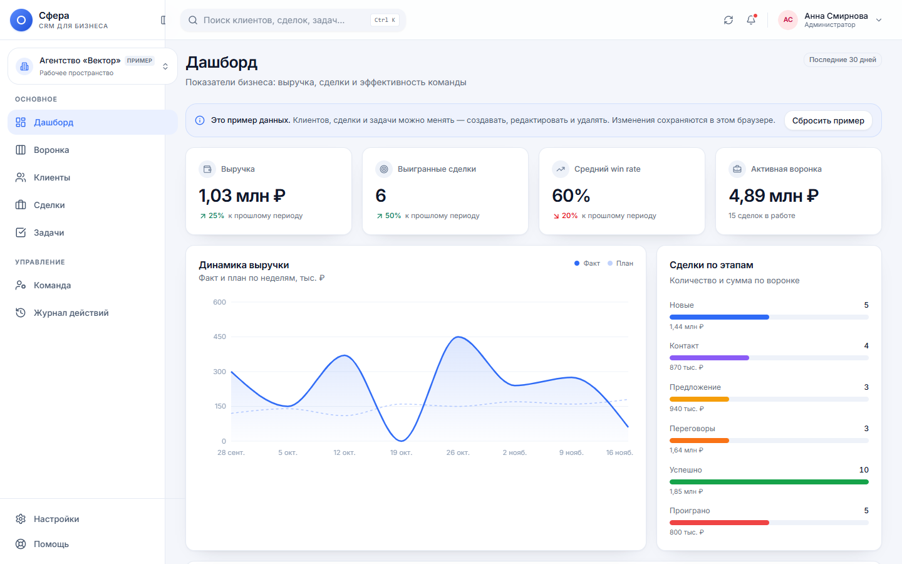
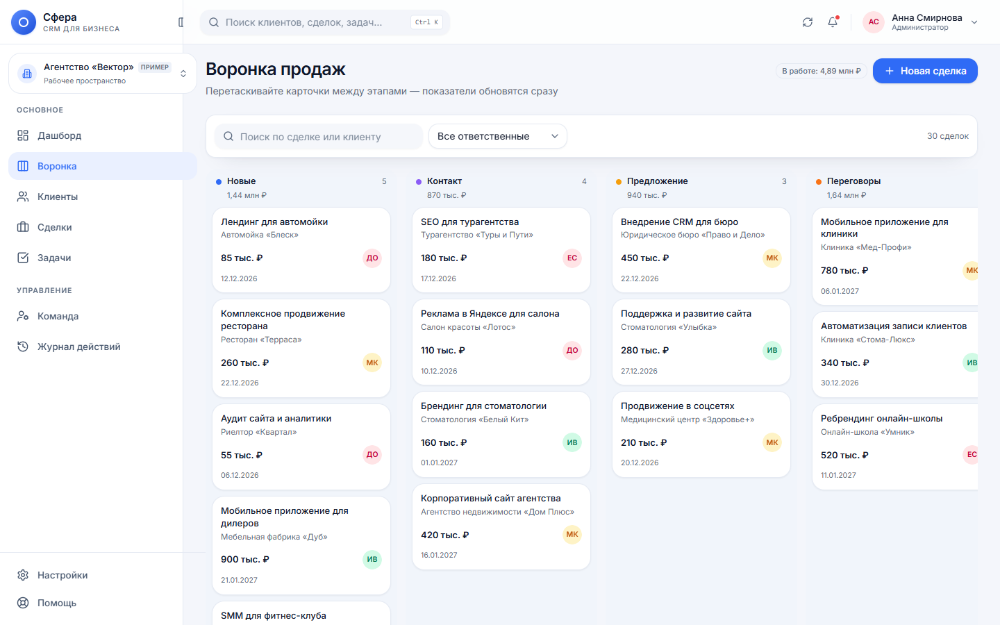
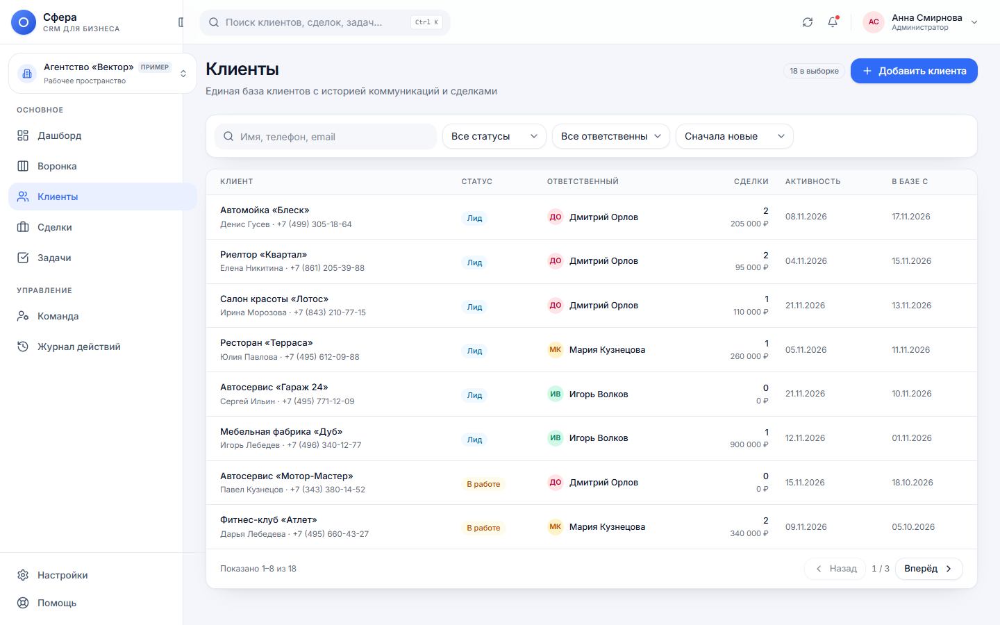

# Сфера CRM

[](LICENSE)

Открытая CRM для малого бизнеса: клиенты, сделки, воронка продаж, задачи и аналитика.
Фронтенд на React + TypeScript, бэкенд на NestJS + PostgreSQL.

[Скачать установщик](../../releases/latest) · [Участие в разработке](CONTRIBUTING.md) · [Лицензия MIT](LICENSE)



## Возможности

- **Клиенты** — CRUD, поиск по имени/телефону/email, фильтры, сортировка, пагинация.
- **Карточка клиента** — контакты, сделки, история коммуникаций и задачи в одном окне.
- **Воронка продаж** — Kanban с перетаскиванием сделок, суммами по этапам и фильтрами.
- **Сделки** — реестр с этапами, суммами и ответственными.
- **Задачи** — просроченные, сегодня, неделя, позже; приоритеты и исполнители.
- **Дашборд** — выручка, win rate, активная воронка, динамика по неделям, топ менеджеров.
- **Команда и роли** — Admin / Manager / Employee и матрица прав.
- **Журнал действий** — кто и когда изменил данные.
- **Пример данных** — 18 клиентов, 30 сделок и 13 задач, которые можно менять и сбросить.

| Воронка | Клиенты |
| --- | --- |
|  |  |

## Стек

| Слой | Технологии |
| --- | --- |
| Фронтенд | React 19, TypeScript 5.7, Vite 6, React Router 7 |
| UI | Tailwind CSS 4, Radix UI, shadcn-подход, Lucide, Recharts |
| Данные | TanStack Query 5, Zod, React Hook Form |
| Бэкенд | NestJS 11, Prisma 6, PostgreSQL 17, Swagger |
| Тесты | Vitest (логика), Playwright (UI smoke), Jest (API) |
| Инструменты | ESLint, Prettier, GitHub Actions, Inno Setup 6 |

## Быстрый старт

Требуется Node.js 22+ и npm 10+. Права администратора не нужны.

```bash
git clone https://github.com/alexpops979-commits/sfera-crm.git
cd sfera-crm
npm install

# Портативные PostgreSQL 17 и Git в %USERPROFILE%\.devtools (Windows)
powershell -ExecutionPolicy Bypass -File scripts/setup-tools.ps1

copy apps\api\.env.example apps\api\.env
npm run db:start
npm run dev
```

- Web: http://localhost:5173
- API: http://localhost:3000/api/v1/health
- Swagger: http://localhost:3000/docs

> На Windows с кириллицей в имени пользователя `initdb` падает на кодировке.
> `scripts/db.ps1` обходит это: создаёт кластер WIN1251 и рабочие базы UTF8/ICU.
> Подробности — в `scripts/db.ps1`.

## Установщик для Windows

```bash
npm run build:installer
```

Собирает `dist/SferaCRM-Setup-0.1.0.exe` (~27 МБ).

Что делает установщик:

- ставит приложение в `%LOCALAPPDATA%\Programs\SferaCRM` без прав администратора;
- добавляет ярлыки на рабочий стол и в меню «Пуск»;
- запускает локальный сервер на `127.0.0.1:4173` и открывает приложение в отдельном
  окне Chrome/Edge (без вкладок и адресной строки);
- создаёт запись «Программы и компоненты» для удаления.

Требования: Windows 10/11 x64 и Chrome или Edge. Данные примера хранятся в профиле
браузера и не удаляются при обновлении.

## Текущий статус

Версия **0.1.0** — рабочий интерфейс и пример данных. Аутентификация, API и PostgreSQL
ещё не подключены к интерфейсу: изменения сохраняются в `localStorage` браузера.
Схема, миграции и API появятся на следующем этапе — см. дорожную карту.

## Структура

```
CRM/
├─ apps/
│  ├─ api/            NestJS + Prisma (REST, /api/v1)
│  └─ web/            React + Vite + Tailwind
├─ packages/
│  └─ shared/         Общие типы, форматтеры, константы (@crm/shared)
├─ installer/         Inno Setup: скрипт, payload, сервер и лаунчер
├─ scripts/           PostgreSQL, ярлыки, скриншоты, smoke-тесты
├─ docs/              Скриншоты для документации
└─ package.json       npm workspaces
```

## Тесты и проверки

```bash
npm test           # Vitest: метрики, задачи, переходы сделок
npm run lint       # ESLint
npm run typecheck  # TypeScript во всех пакетах
npm run smoke:ui   # Playwright: разделы, формы, карточки, drag & drop
npm run build      # сборка всех пакетов
```

`smoke:ui` требует запущенный dev-сервер. Lighthouse на дашборде: 100 / 100 / 100.

### CI

Готовый workflow лежит в [`docs/ci-workflow.yml`](docs/ci-workflow.yml): lint, typecheck,
build и тесты на каждый push и pull request. Чтобы включить его, скопируйте файл в
`.github/workflows/ci.yml` через веб-интерфейс GitHub — загрузка workflow-файлов токеном
требует отдельного scope `workflow`.

## Дорожная карта

- [x] Каркас monorepo: API, Web, shared
- [x] UI-кит, дашборд, канбан, клиенты, задачи, команда, журнал
- [x] Пример данных с созданием, редактированием и удалением
- [x] Тесты логики и UI smoke, доступность, code-splitting
- [x] Установщик для Windows
- [ ] **Этап 1:** схема Prisma, JWT-аутентификация, multi-tenancy, инвайты
- [ ] **Этап 2:** API клиентов (поиск, фильтры, пагинация)
- [ ] **Этап 3:** сделки и воронка на API
- [ ] **Этап 4:** RBAC и управление сотрудниками
- [ ] **Этап 5:** дашборд на реальных данных
- [ ] **Этап 6:** коммуникации, задачи и напоминания
- [ ] **Этап 7:** экспорт CSV / Excel
- [ ] **Этап 8:** audit log с diff
- [ ] **Этап 9:** интеграционные тесты API
- [ ] **Этап 10:** деплой SaaS

## Участие в разработке

Issues и pull request'ы приветствуются. Начните с [CONTRIBUTING.md](CONTRIBUTING.md):
там запуск, стиль коммитов и чек-лист перед PR. Метки `good first issue` помогут
выбрать первую задачу.

## Лицензия

[MIT](LICENSE) © 2026 Sfera CRM contributors.
